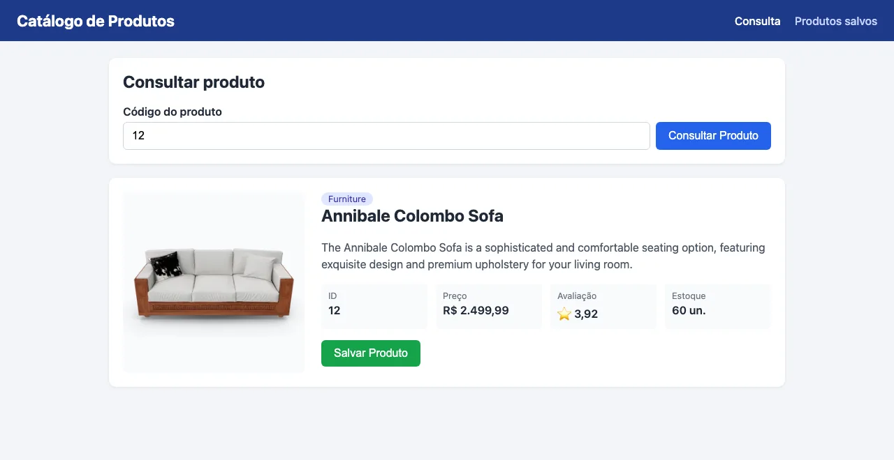
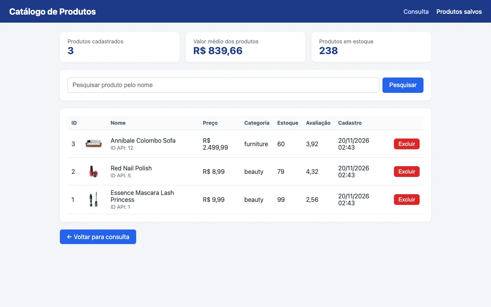
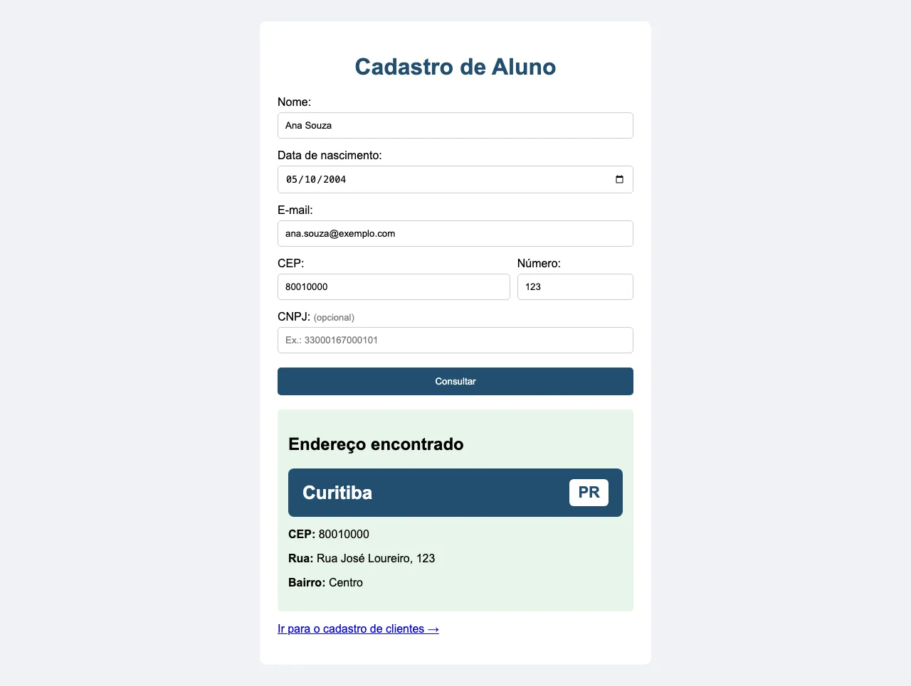
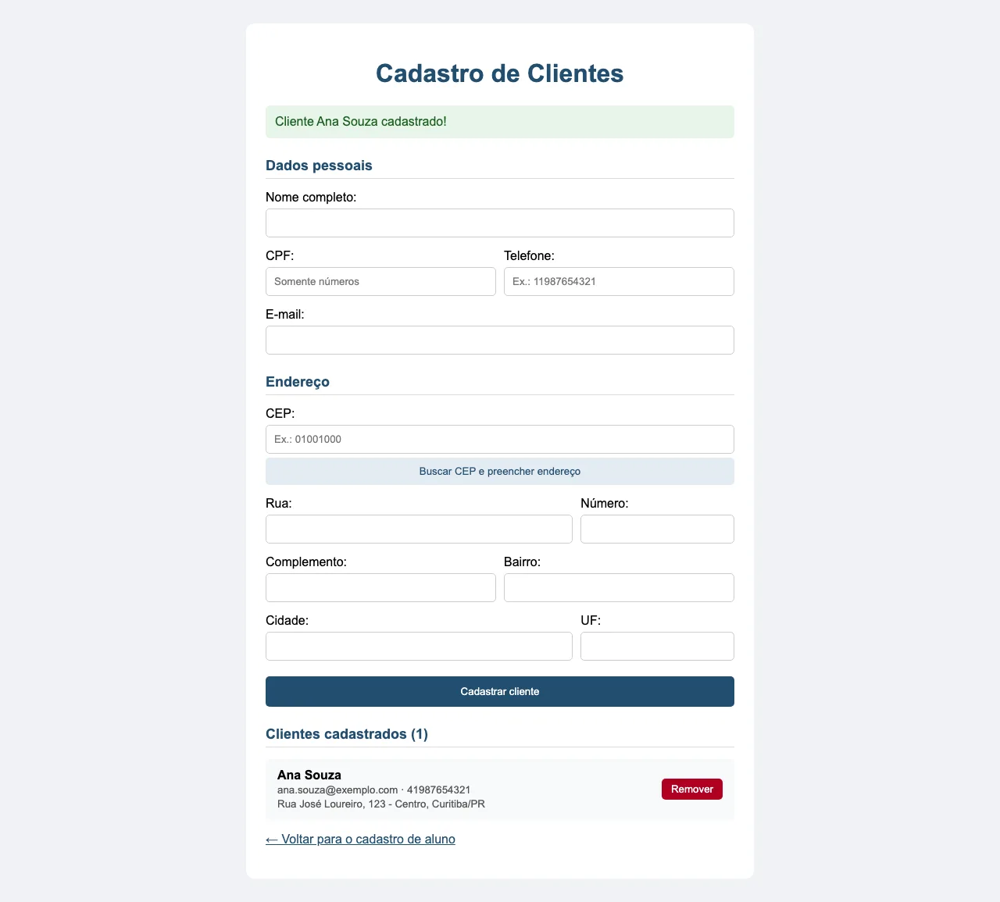
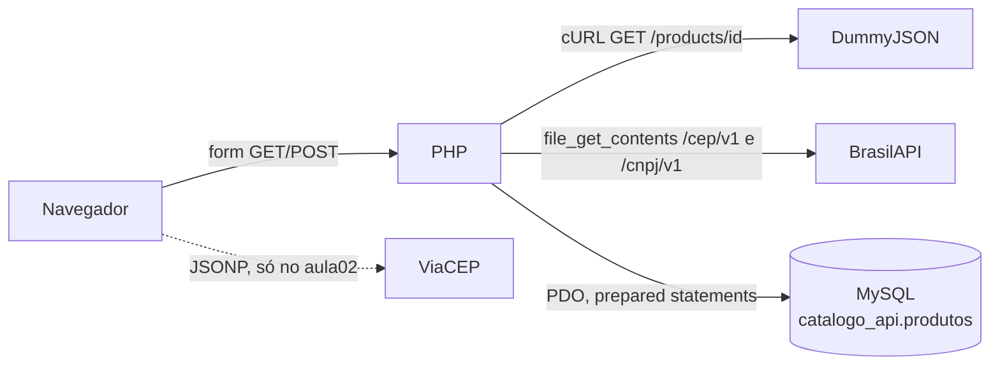

# APIs Faculdade

Exercícios da disciplina **Padrões de Projeto, Frameworks e APIs** (ADS, Senac São José dos Pinhais).

| Data | Atividade | Onde |
|---|---|---|
| Aula 02 | Primeiro JSON e primeira integração (ViaCEP) | [`aula02-primeira-integracao/`](aula02-primeira-integracao) |
| 06/10 | Mini-projeto: Catálogo de Produtos via API REST (DummyJSON + MySQL), com os 4 desafios extras e as respostas de reflexão | [`catalogo-api/`](catalogo-api) |
| Trabalho em equipe | Sistema Acadêmico: API REST de alunos em PHP + MySQL (GET, POST, PUT, DELETE, filtro por curso) | Repositório [sistema-academico-api](https://github.com/PeSzpak/sistema-academico-api) |
| 20/10 | Atividade 01: CEP com número, cidade e UF em destaque, cenários de teste e consulta de CNPJ | [`cadastro-cep/index.php`](cadastro-cep) |
| 20/10 | Atividade 02: formulário próprio de cadastro de clientes | [`cadastro-cep/clientes.php`](cadastro-cep) |
| Projeto | Grão Raro: loja de cafés com checkout real pelo Asaas, API documentada em Swagger | Repositório [grao-raro](https://github.com/PeSzpak/grao-raro) |
| Projeto | Proposta de Solução com APIs de mercado (as 5 questões) | [`proposta-solucao/PROPOSTA.md`](proposta-solucao/PROPOSTA.md) |

## Em funcionamento

| Catálogo via API REST: consulta na DummyJSON | Catálogo: produtos salvos no MySQL, com painel e busca |
|---|---|
|  |  |
| **CEP na BrasilAPI, com cidade e UF em destaque** | **Cadastro de clientes preenchido pelo CEP** |
|  |  |

Dados fictícios. Prints feitos com `php -S` e um MySQL descartável em Docker.

## Como os projetos conversam com as APIs



Nenhum destes projetos expõe uma API própria: eles consomem APIs públicas sem chave. A API REST feita na disciplina (com OpenAPI e coleção Postman) está no repositório [sistema-academico-api](https://github.com/PeSzpak/sistema-academico-api).

## Como rodar os projetos PHP

1. Copie a pasta do projeto para o `htdocs` do XAMPP.
2. Ligue Apache e MySQL no painel do XAMPP.
3. Se o projeto tiver um `.sql`, importe pelo phpMyAdmin.
4. Acesse `http://localhost/<pasta>/`.

As conexões usam o padrão do XAMPP (`localhost`, `root`, sem senha). Para outro MySQL, defina `DB_HOST`, `DB_PORT`, `DB_NAME`, `DB_USER` e `DB_PASS`.

Sem XAMPP, com PHP e Docker instalados:

```bash
docker run -d --name mysql-catalogo -e MYSQL_ALLOW_EMPTY_PASSWORD=yes -p 3307:3306 mysql:8.4
docker exec -i mysql-catalogo mysql -uroot < catalogo-api/banco.sql   # espere o MySQL subir antes
cd catalogo-api && DB_HOST=127.0.0.1 DB_PORT=3307 php -S localhost:8000   # http://localhost:8000
cd cadastro-cep && php -S localhost:8001                                   # não usa banco
```

No PHP 8.5+ o `catalogo-api/index.php` mostra um aviso de depreciação do `curl_close()` (sem efeito desde o PHP 8.0); no PHP 8.2 do XAMPP não aparece.
