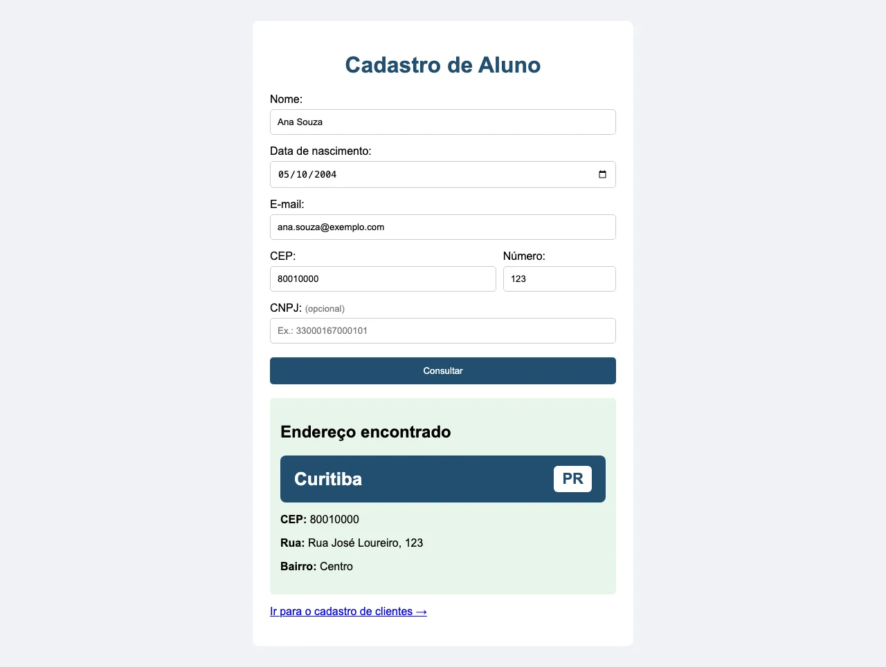

# Atividades 01 e 02 (20/10): CEP, CNPJ e cadastro de clientes

As duas páginas usam a **BrasilAPI** (`/api/cep/v1/{cep}` e `/api/cnpj/v1/{cnpj}`) pelo PHP. As funções de consulta ficam em `consulta.php`, compartilhadas entre as duas telas.

## Atividade 01: `index.php`

| Item | Como ficou |
|---|---|
| 1. Número da residência | Campo "Número" exibido junto à rua no resultado ("Rua José Loureiro, 123"); sem número aparece "s/n" |
| 2. Cidade e estado em destaque | Faixa no topo do resultado, com a cidade em letra grande e a UF num selo |
| 3. Testar cenários | Ver a tabela de testes abaixo |
| 4. Desafio extra: CNPJ | Campo opcional. Os dois dígitos verificadores são conferidos antes de chamar a API, e o resultado mostra razão social, nome fantasia, situação e atividade |

## Atividade 02: `clientes.php`

Formulário próprio de cadastro de clientes: nome, CPF, e-mail, telefone e endereço completo. O botão "Buscar CEP" preenche rua, bairro, cidade e UF. Cada campo é validado no servidor e mostra o erro ao lado. Os clientes ficam guardados na sessão do PHP e podem ser removidos da lista. A atividade não pedia banco de dados.

## Testes realizados (16/11/2026)

| Cenário | Resultado |
|---|---|
| CEP vazio | "Informe o CEP." |
| CEP `8000` (incompleto) | "Informe um CEP com 8 números." |
| CEP `00000000` (inexistente) | "CEP não encontrado." |
| CEP `80010-000` com número 123 | Curitiba / PR em destaque, endereço com ", 123" |
| CNPJ `11.111.111/1111-11` | "CNPJ inválido.", sem chamar a API |
| CNPJ `33.000.167/0001-01` | Petróleo Brasileiro S A Petrobras, com situação e atividade |
| Clientes: buscar CEP `80010000` | Cidade preenchida com Curitiba |
| Clientes: salvar com dados faltando | Erros por campo (nome, CPF, telefone...) |
| Clientes: salvar completo | "Cliente Ana Souza cadastrado!" e a lista mostra 1 cliente |

## Como rodar

Copie a pasta para o `htdocs` do XAMPP, ligue o Apache e acesse `http://localhost/cadastro-cep/`. Não usa banco de dados.
