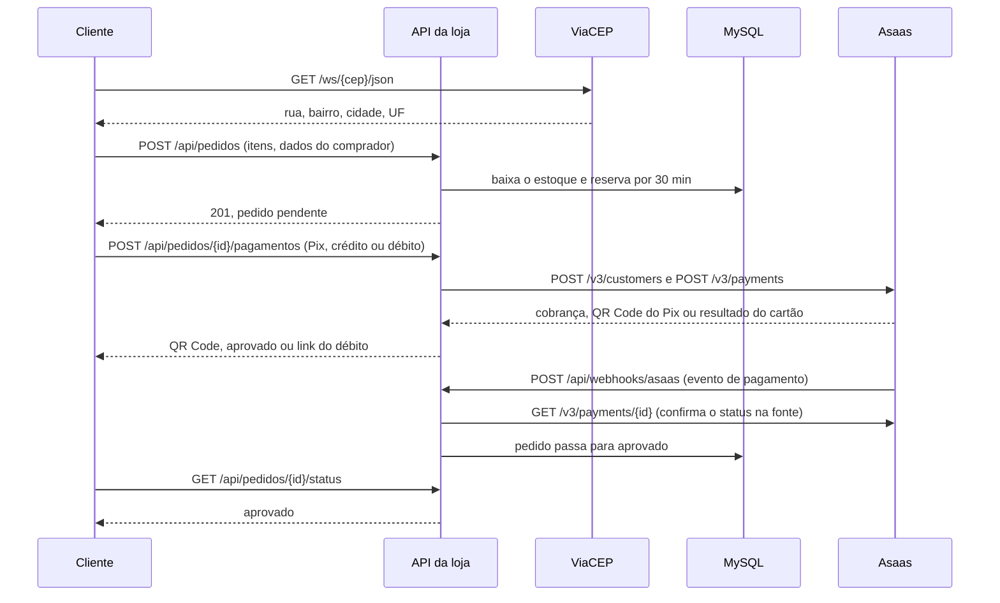

# Proposta de Solução: vendas e pagamentos da Grão Raro

**Equipe:** Pedro Szpak, Ademir Junior e Christian Ferreira
**Disciplina:** Padrões de Projeto, Frameworks e APIs, Senac São José dos Pinhais

## 1. Identificação do problema

A **Grão Raro** é uma torrefação pequena que vende cafés especiais e equipamentos de preparo. Hoje as vendas chegam por WhatsApp e Instagram, e o processo de **venda e confirmação de pagamento** (departamento comercial e financeiro, que são as mesmas duas pessoas) é manual:

1. O cliente pede pelo chat e a atendente calcula o total na mão.
2. A atendente envia a chave Pix e espera o comprovante.
3. Alguém abre o extrato do banco para conferir se o valor caiu.
4. O estoque é baixado numa planilha, quando lembram.
5. O endereço é digitado de novo para gerar a etiqueta de envio.

**Impactos:**
- **Tempo:** cerca de 10 minutos de atendimento por pedido, e a conferência de Pix acumula no fim do dia.
- **Venda perdida:** pedidos que chegam à noite só são respondidos no dia seguinte, e parte dos clientes desiste.
- **Erros de estoque:** dois clientes compram o último pacote de um microlote e um deles precisa ser reembolsado.
- **Risco:** comprovante de Pix falso ou editado passa despercebido, porque a conferência é visual.
- **Endereço errado:** digitado à mão, gera reenvio e frete pago duas vezes.

## 2. Proposta de solução

Uma **loja on-line com checkout integrado**, em que o cliente escolhe os produtos, informa o CEP e paga sozinho, a qualquer hora. A confirmação do pagamento chega automaticamente da instituição de pagamento.

| Etapa | Antes | Depois |
|---|---|---|
| Montar o pedido | Atendente calcula no chat | Carrinho calcula o total |
| Endereço | Digitado pela atendente | O CEP preenche rua, bairro, cidade e UF |
| Reservar estoque | Planilha, depois da venda | Baixa automática quando o pedido é criado, reservado por 30 minutos |
| Cobrança | Chave Pix enviada no chat | Pix com QR Code, cartão de crédito ou débito, gerados pela API |
| Confirmação | Conferência manual do extrato | Webhook avisa o sistema, que confirma consultando a API |
| Pedido não pago | Esquecido | Reserva expira e o estoque volta sozinho |
| Estorno | Transferência manual | Botão no painel administrativo |

## 3. Escolha das APIs

| API | Finalidade |
|---|---|
| **Asaas API v3** | Criar clientes e cobranças (Pix, cartão de crédito e débito), receber o QR Code do Pix, consultar o status do pagamento, estornar e enviar webhooks quando o pagamento muda de situação |
| **ViaCEP** | Preencher o endereço de entrega a partir do CEP digitado no checkout |
| **API própria da loja (REST + JSON)** | Expor catálogo, carrinho, pedidos e status para o site e para um futuro app, documentada em OpenAPI/Swagger |
| **MySQL** | Guardar produtos, estoque, pedidos, pagamentos e eventos de webhook já processados |

## 4. Funcionamento da integração

**Dados em cada etapa:**
- **Cliente → ViaCEP:** envia o CEP; recebe o endereço em JSON.
- **Cliente → API da loja:** envia itens (id e quantidade), nome, e-mail, CPF e endereço; recebe o id do pedido e o total calculado no servidor (o preço nunca vem do navegador).
- **API da loja → Asaas:** envia o cliente (nome, CPF, e-mail) e a cobrança (valor, vencimento, forma de pagamento e o id do pedido como referência externa); recebe o id da cobrança e o QR Code ou o resultado do cartão.
- **Asaas → API da loja (webhook):** envia o tipo do evento e o id da cobrança. A loja não confia no corpo do webhook: confere o token do cabeçalho e consulta o status direto na API do Asaas antes de mudar o pedido.

## 5. Resultados esperados e viabilidade

| Critério | Benefício |
|---|---|
| Economia de tempo | O atendimento por pedido cai de cerca de 10 minutos para zero; a equipe só embala e envia |
| Redução de custos | Sem horas gastas conferindo extrato; menos reenvio por endereço errado |
| Menos erros | O estoque é baixado numa transação única, e a última unidade não é vendida duas vezes |
| Produtividade | A loja vende de madrugada e no fim de semana sem ninguém online |
| Experiência do cliente | Paga na hora com Pix ou cartão e acompanha o status do pedido na tela |
| Segurança | Sem comprovante falso, porque a confirmação vem da instituição de pagamento; os dados do cartão vão direto para o Asaas, sem ficar gravados na loja |

**Viabilidade:** o Asaas não cobra mensalidade, só uma tarifa por cobrança recebida (por exemplo, R$ 0,99 por Pix); o ViaCEP é gratuito; a hospedagem cabe no plano gratuito da Vercel e de um MySQL gerenciado.

**Como demonstramos que funciona:** a solução foi construída e está no ar em https://grao-raro.sinovaz.com, com o código em https://github.com/PeSzpak/grao-raro.
- Uma compra ao vivo de R$ 5,00 por Pix na conta de produção: o pedido muda para aprovado sozinho, pelo webhook, e depois é estornado pelo painel.
- A documentação da API no Swagger (`/docs`) e uma coleção do Postman rodando todos os endpoints.
- Testes automatizados, incluindo dez compras simultâneas da última unidade, que resultam em um pedido aprovado e nove recusados por falta de estoque.
